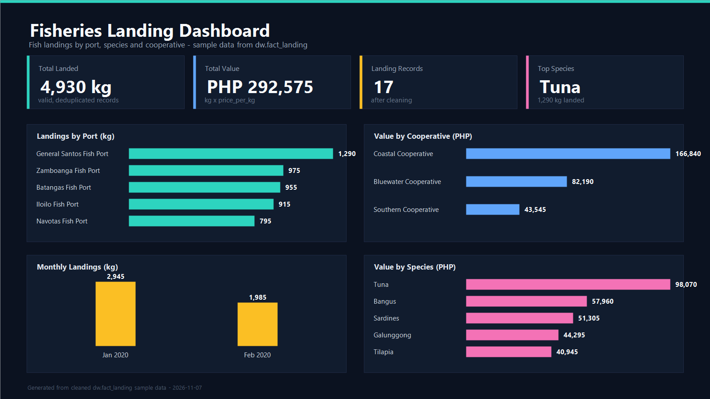

# Fisheries Data Warehouse

A PostgreSQL star-schema data warehouse for fish landing data. It contains a
complete ETL flow (extract -> clean -> load), data quality checks, star queries,
and a Slowly Changing Dimension (SCD Type 2) implementation for vessels.

## Repository structure

```
fisheries_d/
│
├── database/
│   ├── schema.sql
│   ├── lab1_fisheries_star_schema.sql
│   ├── lab2_etl_pipeline.sql
│   └── lab3_data_cleaning.sql
│
├── powerbi/
│   └── abdurahmandataset_dashboard.pbix
│
├── datasets/
│   └── raw_landing.csv
│
├── screenshots/
│   └── dashboard.png
│
└── README.md
```

## Database scripts

`database/schema.sql` is the full combined script (star schema plus the ETL and
data-cleaning activity) and can be run on its own. The `lab*` files are the same
pipeline broken into labeled, runnable steps; run them in order. Each file is
wrapped in its own transaction.

1. **`lab1_fisheries_star_schema.sql`** — creates the `dw` schema, the
   dimensions (`dim_date`, `dim_port`, `dim_species`, `dim_vessel`), the
   `fact_landing` table, the indexes, the `UNKNOWN` members (key `0`), and
   populates `dim_date` for 2020–2030.
2. **`lab2_etl_pipeline.sql`** — extracts the raw landings into
   `raw_landing`, cleans and deduplicates them, loads the dimensions and fact
   table, runs the star queries, and demonstrates the SCD Type 2 change for
   vessel `V001`.
3. **`lab3_data_cleaning.sql`** — profiles the raw data, rebuilds the cleaned
   staging tables (`clean_landing`, `rejected_landing`) with the full cleaning
   rules, and prints data quality checks. Requires `lab2_etl_pipeline.sql`,
   because it reads `dw.raw_landing`.

Cleaning rules:

- Trim whitespace and normalize text casing.
- Deduplicate on the business key (date, port, species, vessel, kg, price).
- Route invalid rows (missing date, non-positive kg or price) to
  `rejected_landing` with a reason instead of dropping them silently.
- Resolve unresolved dimension references through the `UNKNOWN` members.

## Getting started

Requirements:

- PostgreSQL 12 or newer (tested on 18)
- Power BI Desktop (for the dashboard)

Run the full schema:

```bash
createdb fisheries
psql -U postgres -d fisheries -f database/schema.sql
```

Or run the labeled steps in order:

```bash
psql -U postgres -d fisheries -f database/lab1_fisheries_star_schema.sql
psql -U postgres -d fisheries -f database/lab2_etl_pipeline.sql
psql -U postgres -d fisheries -f database/lab3_data_cleaning.sql
```

`lab1` drops and recreates the `dw` schema, so the full sequence can be re-run
safely. `lab2` also resets its target dimension and fact rows before loading.

## Datasets

`datasets/raw_landing.csv` is the messy source dataset used by the ETL. The
script inserts the same rows into `dw.raw_landing`. The cleaned, dimensional,
and fact tables are derived from it by the pipeline.

## Power BI dashboard

Open `powerbi/abdurahmandataset_dashboard.pbix` in Power BI Desktop and point
the PostgreSQL connection to your local database. Use the tables in the `dw`
schema (`dim_*` and `fact_landing`).

## Screenshots



## Notes

The image at `screenshots/dashboard.png` is a generated summary visual built
from the cleaned sample data; replace it with a Power BI screenshot if
preferred.
